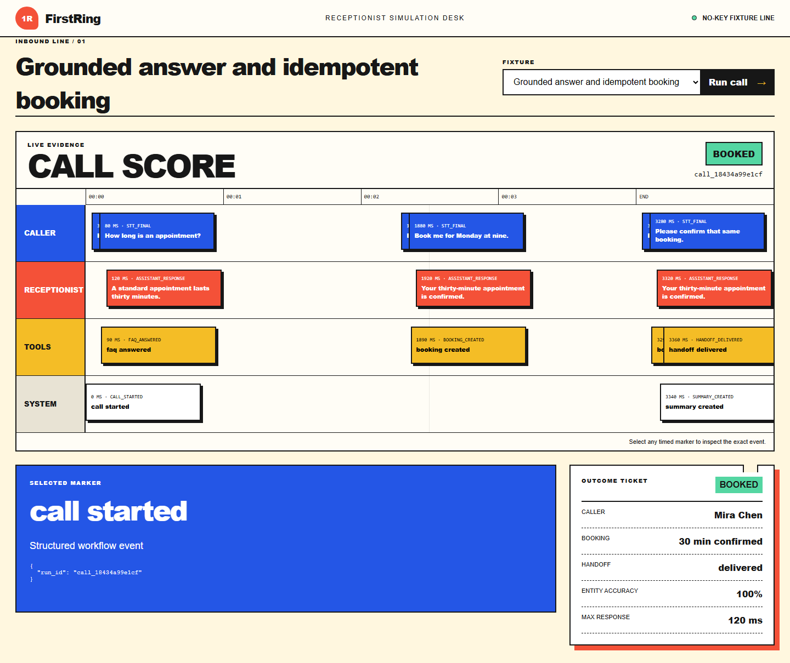

# FirstRing

FirstRing is a voice-receptionist starter for qualification, FAQ routing,
booking, transfer, structured call summaries, and reliable downstream
handoffs. Its prepared call scenarios run without credentials.

It demonstrates:

- streaming STT/LLM/TTS contracts and a real no-key LiveKit `AgentSession`
  seam;
- grounded FAQ matching with an explicit not-found transfer;
- timed turns, visible interruption, entity-accuracy and response-latency
  fixtures;
- business-hours, opt-out, human-transfer and provider-recovery rules;
- timezone-aware, collision-safe, idempotent booking and deterministic CRM
  mapping reused from LeadDock;
- structured call summaries delivered through DeliveryGuard with bounded
  retry, dead-letter state and replay.



[Open the live call workspace](https://sutasmantas.github.io/ai-voice-receptionist/)

## Quickstart

Python 3.10–3.14 is supported.

```powershell
python -m venv .venv
.\.venv\Scripts\python -m pip install vendor\deliveryguard-0.1.0-py3-none-any.whl
.\.venv\Scripts\python -m pip install -e . pytest pytest-asyncio pytest-cov ruff mypy build twine httpx httpx2
.\.venv\Scripts\firstring-demo --scenario successful-booking
.\.venv\Scripts\python -m uvicorn firstring.app:app --port 8000
```

Open `http://127.0.0.1:8000`. Select a fixture and run it on the call score.
The failure fixture exposes a replay control after the webhook dead-letters.

## Verification

```powershell
.\.venv\Scripts\python -m ruff check src tests
.\.venv\Scripts\python -m ruff format --check src tests
.\.venv\Scripts\python -m mypy -p firstring
.\.venv\Scripts\python -m pytest -q --cov=firstring --cov-report=term-missing
.\.venv\Scripts\python -m build
.\.venv\Scripts\python -m twine check dist\*
docker build -t firstring:p5 .
```

The optional LiveKit hosted-provider entrypoint is
`python src/agent.py console|dev|start`. It requires appropriate LiveKit and
model-provider configuration.
